# Banner Camp: lobby preview

A walkable, in-browser model of what the finished Graves and Glory lobby should look like, made for the builder.
Everything is built from Minecraft-style blocks (full blocks, slabs, stairs, walls, fences, panes, lanterns...), with the
nearest vanilla block named for every material, so it can be rebuilt in-game block for block.

It is a design reference, not game code: nothing in `src/main` (the mod) uses it.

## Run it

```bash
cd lobby-preview
./start.sh            # or: python3 -m http.server 8080
```

Then open <http://localhost:8080>. (Windows: double-click `start.bat`.) Chrome, Edge, Firefox and Safari work; it needs WebGL2.
Three.js is vendored in `vendor/`, so it works offline. The page loads the game's fonts from Google Fonts when online and
falls back to Georgia / system fonts when not.


## A look before you run it

| | |
|---|---|
| 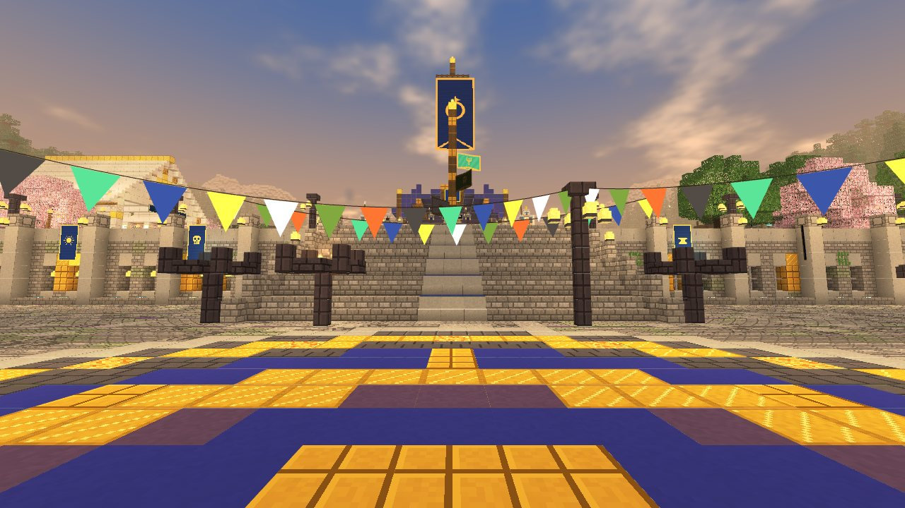 **Spawn plaza:** the Hollow Seal, bunting, the Chapter Wall, the stair and the standard | 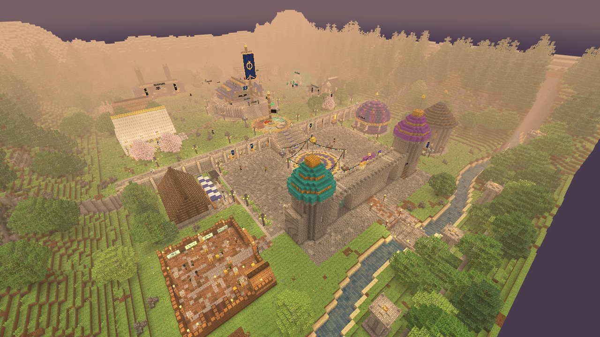 **The whole camp** from the southwest |
| 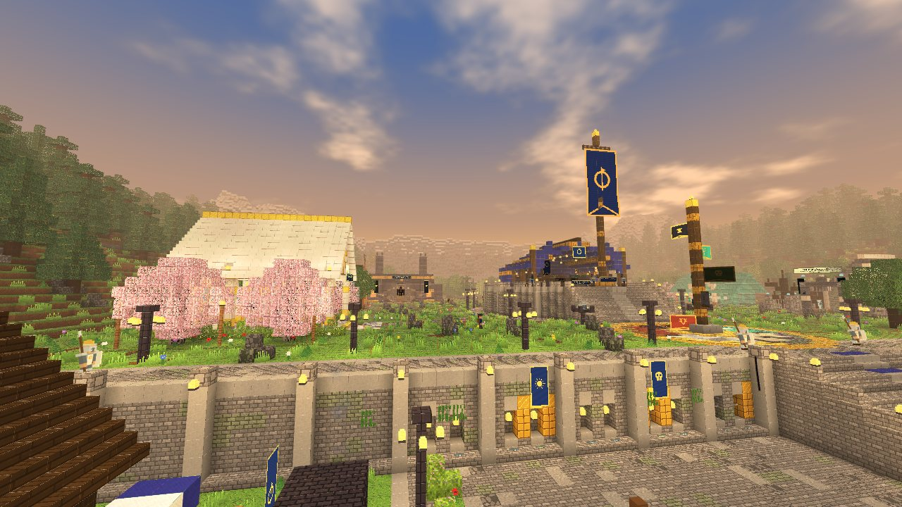 **The House Terrace** above the Chapter Wall: Gilded, the Command Hill and the Muster Standard | 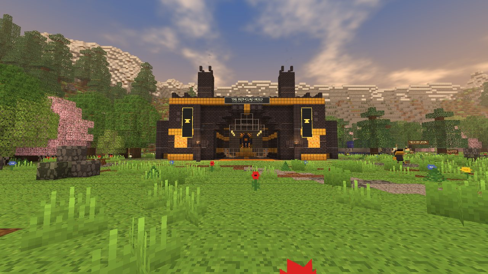 **Ironclad Hold:** brass-and-soot forge gate |
| 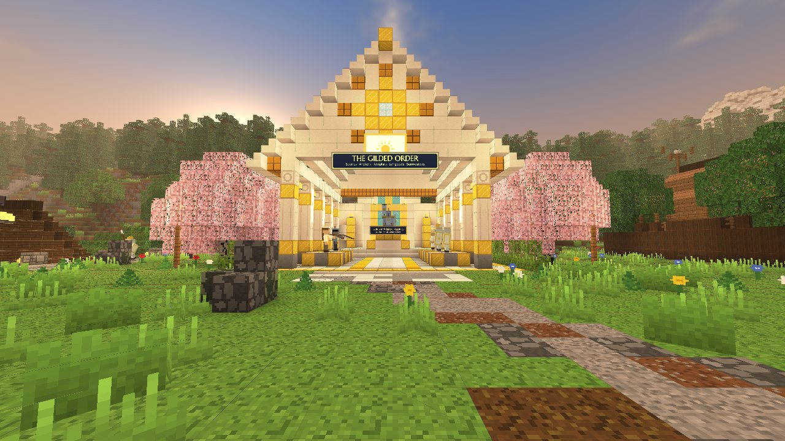 **Gilded Oathhall** | 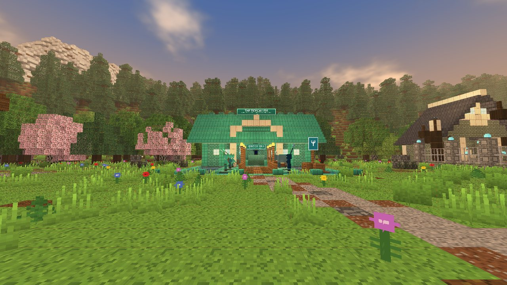 **Tidecallers' Tidepost** |
| 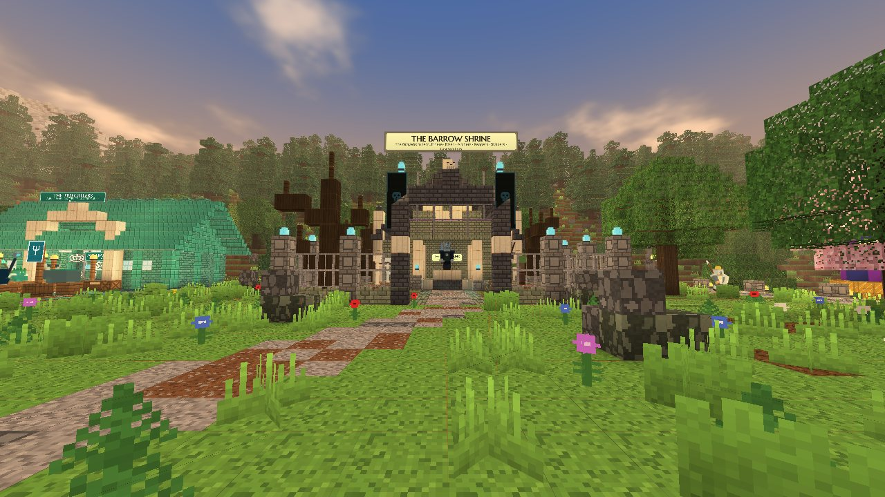 **Graveborn Barrow Shrine** | 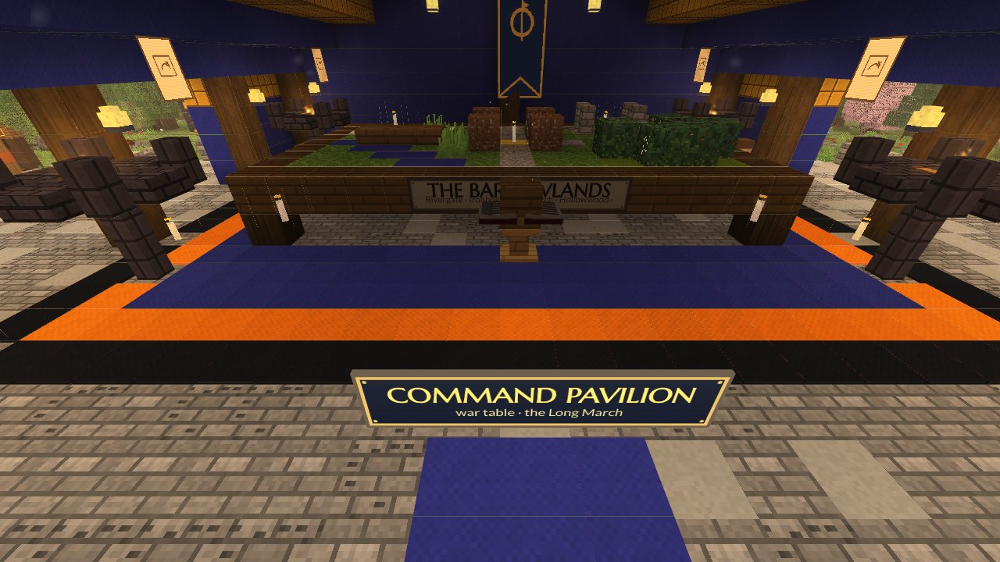 **Command Pavilion** and the war table on top of the Command Hill |
| 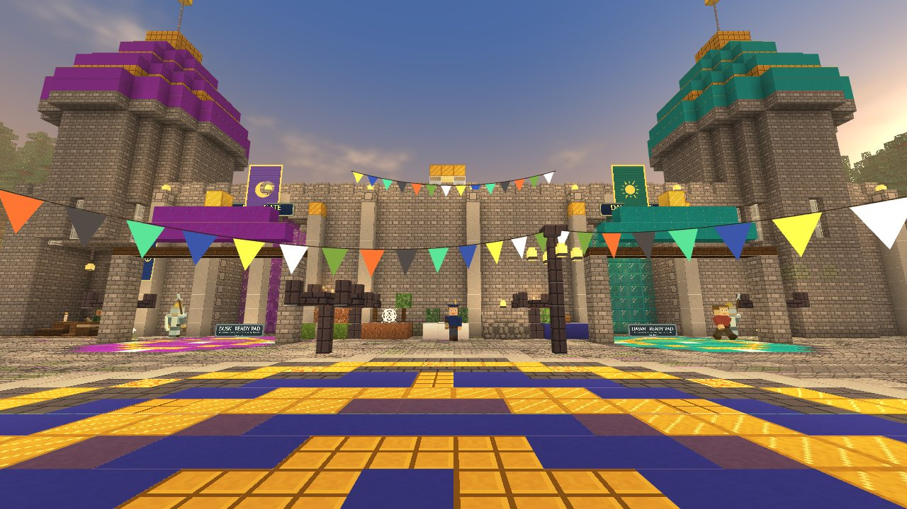 **War Gates** (Dawn teal, Dusk violet) | 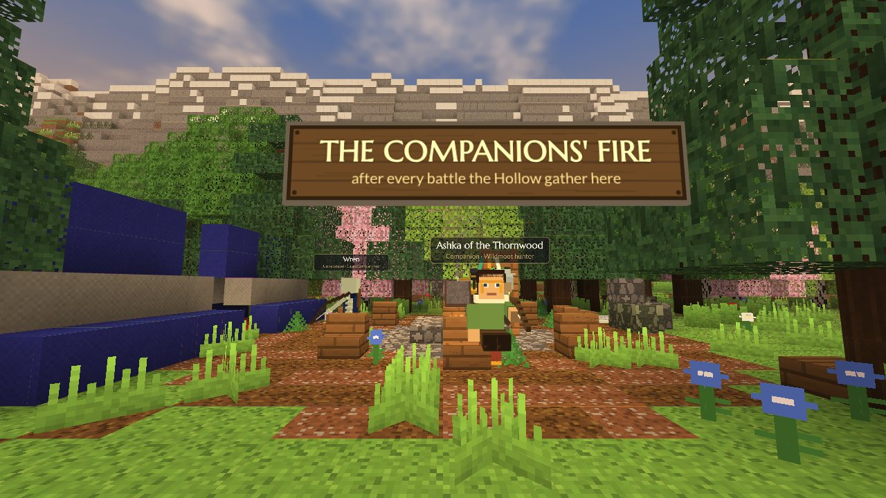 **The Companions' Fire** |
| 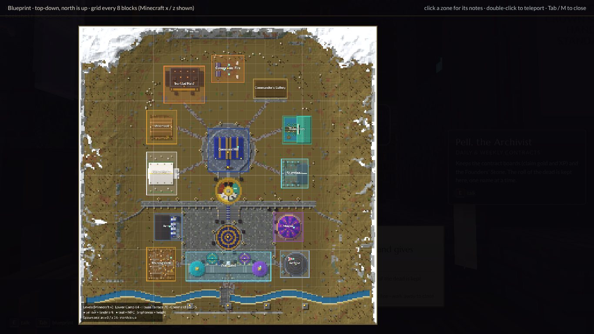 **Blueprint map** (Tab) | 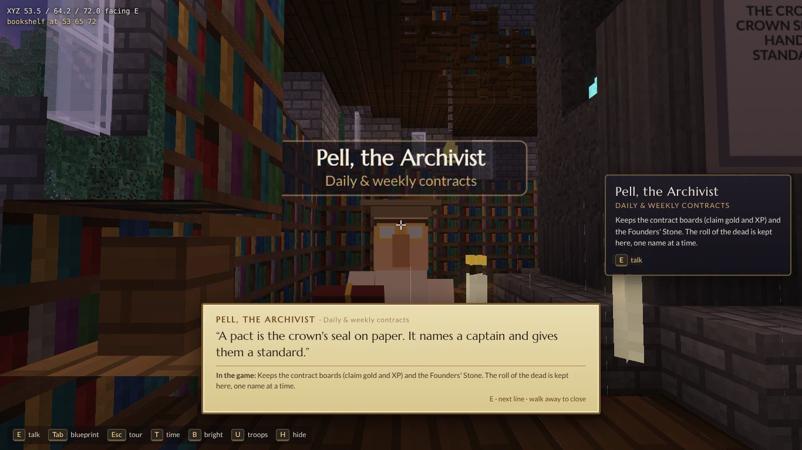 **Talk to the keepers** (E) |

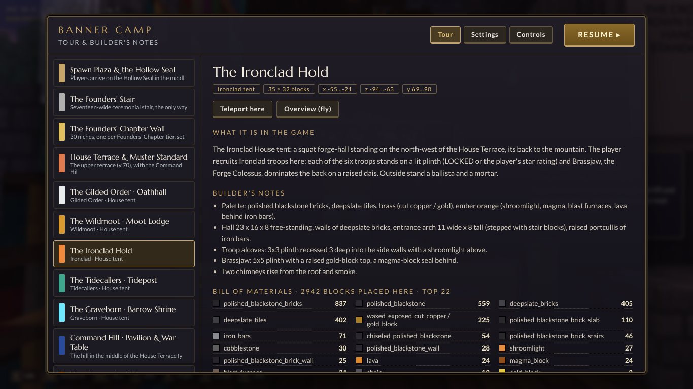

## What you can do

| Key | Action |
|---|---|
| W A S D, Shift, Space | walk, sprint, jump (tap Space twice to fly, C to go down) |
| Mouse | look (click *Enter the camp* to capture the mouse) |
| E | talk to the NPC you are looking at; troops show a stat card automatically |
| Tab or M | top-down blueprint map with a grid in Minecraft coordinates, zone outlines, NPCs and landmarks. Click a zone for notes; double-click to teleport |
| Esc | Tour: every zone with what it does in the game, the builder's notes and a bill of materials |
| Click | copy the coordinates of the block under the crosshair (the HUD also names the vanilla block) |
| 1 .. 9, 0 | jump to the main areas |
| T | cycle time of day: dusk, golden hour, night, dawn, noon |
| B | bright mode (flat light, useful for counting blocks) |
| U | cycle troop displays: mixed / all unlocked / all locked |
| P | save a PNG screenshot |

Coordinates match a Minecraft world: the Lower Camp floor is **y 64**, the House Terrace **y 70**, the Command Hill **y 76**.
`x` runs east, `z` runs south, the spawn seal is at **x 0, z 53**, north is up on the blueprint.

## The layout in one paragraph

You arrive on the Hollow Seal in the middle of the **Lower Camp**, a wide open plaza (no building closer than 9 blocks to another). Four
service buildings stand on its edges with their doors facing the seal: the Armory (Quartermaster) and the Training Yard (Drillmaster,
START arch for battle 1) on the west, the Muster (Recruiter) and the Archive (Pell, contracts, the Founders' Stone) on the east. The
War Gates (Dawn teal, Dusk violet) close the south end with the Steward's tower, the Horn tower and the battle-map board, and a road
leads on across a bridge toward five beacon towers, one per battlefield. In front of you the **Founders' Chapter Wall** (30 niches) runs
the whole width of the terrace, with one grand stair up to the **House Terrace**: the five-House mosaic and the Muster Standard at the
head of the stair, the **Command Hill** (war tent, relief war table, storybook, Hollow Standard) in the middle, and the Houses on a wide
arc around it, every door facing the hill: Gilded Oathhall and the Barrow Shrine flank the entrance, Wildmoot Lodge and the Ironclad Hold
stand on the west, the Tidecallers' Tidepost and the Commander's Gallery (six classes) on the east, and the Companions' Fire is a quiet
glade behind the hill. Roads run out from the hill like spokes to every House door. Trees grow only on the slopes and at the outskirts,
never between buildings. The layout plan this was built from: [`previews/banner-camp-new-layout.png`](previews/banner-camp-new-layout.png).

## How it is made

* `src/blocks.js`: block catalogue (each with its vanilla `mc` name) and a procedurally painted 16 px texture atlas. No game or Minecraft assets are used.
* `src/world.js`: voxel storage, a small building DSL (`Pen`), Minecraft-style sky/block light flood fill, smooth lighting and ambient occlusion, chunk mesher.
* `src/lobby/layout.js`: where everything stands (one table of positions, rotations and zone rectangles; change a building's place here).
* `src/lobby/*.js`: the design itself, one file per area. Each area is plain block-placement code (`fill`, `walls`, `gable`, `disc`...), so it reads like a build plan.
* `src/figures.js`, `src/catalog.js`: the voxel troops, NPCs, beasts and siege engines. `src/data.js`: troop stats and NPC notes taken from `docs/superpowers/specs`.
* `src/entities.js`, `src/particles.js`, `src/ui.js`: signs, banners, labels, particles, HUD, tour and blueprint.

Colours and Houses follow the repo's design documents (Houses spec, story spec, UI spec). Everything beyond what those
documents fix is a proposal, and is called out as such in the builder's notes.
